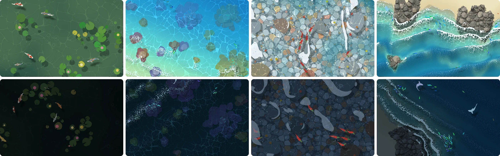

# Koi Pond Simulator

A Chrome extension that puts a living water scene on every new tab: a coral reef, a mountain
stream, a koi pond or a beach, by day or by night, with fish that swim away from your cursor. Over
it, a clock and a search box (each optional), a settings dialog behind the gear in the corner, and a
button beside it that lays the scene out afresh. The water also runs on its own as a
[wallpaper](#as-a-wallpaper), and comes as an [npm package](#as-a-package) for your own pages.



Version 1.0 is a rebuild of the 2019 Koi Pond Simulator (Manifest V2, taken down with it), ported
from the background of the [About page of alexngai.com](https://alexngai.com/about/).

## Settings

- **Scene**: Random (a new one for each tab), Reef, Stream, Pond or Beach.
- **Time of day**: Auto (day from 07:00 to 19:00, both adjustable), or always Day or Night.
- **Show**: the clock, the search box (it searches with Chrome's default search engine).

They're kept in Chrome's synced storage, so they follow you between computers.

## As a wallpaper

The water also runs on its own, full screen, with nothing over it, at
[alexngai.github.io/koipond](https://alexngai.github.io/koipond/): for a desktop wallpaper, a
screen saver or a TV's browser. Its address sets it up:

- `scene`: `reef`, `stream`, `pond` or `beach` every time, or `random` (the default), a new one each
  load.
- `time`: `day` or `night` always, or `auto` (the default) by the clock: day from `day` until
  `night` (`HH:MM`, 07:00 and 19:00 unless given).
- `cycle`: minutes between new layouts (0, the default: never). With a random scene, each is a
  different scene too.
- `quality`: `0` (all of it) to `4`, to pin how much it spends on looks. Unless it's given, it steps
  down by itself where frames come slowly (a big screen, a slow machine) and back up when there's
  room (`src/water/quality.ts`).

For example `?scene=beach&day=06:30&night=20:00&cycle=15`. On a Mac,
[Plash](https://sindresorhus.com/plash) shows it as the desktop wallpaper. It keeps the GPU busy,
so on battery it costs some power.

It's `index.html` and `src/wallpaper.ts`, built on its own into `pages/` (`npm run build:pages`) and
deployed to GitHub Pages on each push to `main` (`.github/workflows/pages.yml`).

## As a package

The water and its fish are also an npm package, `koipond-sim`, for putting a pond behind a page of your
own (the [About page of alexngai.com](https://alexngai.com/about/) is one):

```sh
npm install koipond-sim
```

```ts
import { createPond, SCENES } from 'koipond-sim';

const pond = createPond({ scene: 'reef', time: 'night' }); // null where there's no WebGL
pond?.setScene('beach'); // crossfades to it
pond?.setTime('day'); // eases into it
pond?.reroll(); // a new random layout, with new fish
pond?.destroy(); // stops it and takes it off the page
```

It needs a browser (a bundler, or a `<script type="module">`); importing it on a server is fine,
creating a pond there is not. Options, all optional:

- `scene`: `'reef'`, `'stream'`, `'pond'` or `'beach'` (`SCENES` lists them). One at random unless
  given.
- `time`: `'day'` (unless given) or `'night'`.
- `fish`: `false` for the water alone.
- `quality`: `0` (all of it) to `4`, to hold its detail. Unless given, it steps down by itself where
  frames come slowly (a big screen, a slow machine) and back up when there's room, remembering where
  it settled for the screen.
- `container`: the element it goes in, as its first child (`document.body` unless given).
- `zIndex`: its z-index, `-1` unless given: behind the page. `'auto'` leaves it in the page's own
  order instead (as this repo's pages do, with their controls after it).
- `flow`: draws the stream's current and the beach's surf model instead, for working on them.

It fills the window, behind everything (a fixed layer that lets clicks through), and brings its own
styles, weak enough that a page's win: the layers are in `pond.element` (class `koipond`, with
`data-scene` and `data-time`), the fish on canvases of class `koipond-fish` (e.g.
`.koipond-fish { opacity: 0.6 }` behind text). On a phone the scene is laid out as on a bigger screen
and drawn smaller. One pond to a page at a time.

### To do: composing your own

For now (0.x) the four scenes are presets: each its own water, extras and fish, laid out at random.
What composing them would take, easiest first:

- [ ] **`seed`**, to lay a pond out the same way again: the 57 calls to `Math.random()` in `src/water/`
      drawing on one seeded generator instead.
- [ ] **Your choice of fish in any water** (`fish: [{ kind: 'koi', count: 8 }]`). Each school is tied
      to its scene now (`fish.ts`'s `frame()`: the reef's school fades with the reef, the salmon with
      the stream, …); instead a list per pond, each kind still getting what it needs from the water:
      the salmon a current to hold station in (`water.current`), the beach's fish its depth, to keep off the sand
      (`water.depth`), the damselfish the reef's coral (`water.colonies`).
- [x] **The current as part of the water**, not of the stream scene: `water.current` (strength,
      direction, speed, flow at a point, the boulders it parts round), which every fish swims in;
      each water says how much it has (`CURRENTS` in `scene.ts`; only the stream's, for now).
- [ ] **Your choice of extras** (`extras: ['lilies', 'rain', 'leaves', 'gulls']`): the 2D layers
      (`pond.ts`, the leaves and bubbles in `stream.ts`, `shore.ts`) drawn over any water, each fading
      with its own weight rather than its scene's.
- [ ] **Mixing waters** (a pond's floor under the reef's swell): the hard one. Each scene's water is
      one shader, floor and surface, so a new mix is new GLSL; short of that, some of each shader
      (palette, depth, size of the swell) could be options.

## Developing

```sh
npm install
npm run dev     # the page on its own at http://localhost:5173/newtab.html (settings in localStorage)
npm test        # the day/night timing
npm run build   # type-checks, then builds the extension into dist/
npm run build:pages  # ... or the wallpaper into pages/ (at http://localhost:5173/ in dev)
npm run build:lib    # ... or the package into lib/ (its types in lib/types/); `npm install` and
                     # `npm publish` run it too
npm run zip     # builds, then packs dist/ into release/koi-pond-simulator-<version>.zip for the store
npm run store   # builds, then renders the icons and the store's screenshots and promo tile (needs
                # Google Chrome and Pillow)
```

The page's address can set the scene, time of day, clock and search box for that tab alone:
`newtab.html?scene=pond&time=night&clock=0&search=0`.

To try the extension: build, open `chrome://extensions`, turn on Developer mode, then
**Load unpacked** and pick `dist/`. After rebuilding, press the reload icon on its card. The first
time a new tab opens, Chrome asks whether to keep the change: keep it.

## Layout

- `src/index.ts`: the package: `createPond()`, which makes the water's layers and starts the water
  and fish on them. The pages below use it too.
- `newtab.html`: the page: the clock, search box, reroll button, gear and settings dialog.
- `src/main.ts`: starts it all (the pond, over it the rest) and wires up the settings.
- `index.html`, `src/wallpaper.ts`: the wallpaper: the same water and fish with nothing over them,
  set up by its address. `vite.config.ts` builds it on its own with `--mode pages`, and
  `.github/workflows/pages.yml` deploys it to GitHub Pages.
- `src/settings.ts`, `src/time.ts`: the settings and their storage; day or night by the clock.
- `src/water/`: the scenes. `scene.ts` runs the WebGL water (`*.glsl`, one shader per scene,
  crossfaded), `fish.ts` the schools of fish, and `stream.ts`, `reef.ts`, `pond.ts` each scene's
  extras (the stream's boulders, leaves and bubbles, the reef's coral, the pond's lilies and rain).
  The reef and the beach ride a surf model (`surf.ts`, `surf.glsl`): a seabed and the swell crossing
  it, worked out once per layout, that both shade their water from and `beach.ts` rides its
  particles on; `shore.ts` has the beach's crab and gulls, and `glints.glsl` the caustics painted
  onto the fish. `newtab.html?scene=beach&flow` draws the beach's surf model instead.
- `public/manifest.json`: the extension's manifest (Manifest V3), copied into `dist/` as is. Its
  `version` names the zip; raise it for each store upload.
- `store/`: what the Chrome Web Store needs: the listing and privacy answers (`listing.md`), a
  privacy policy, screenshots, the promo tile, the icon's source (`icon.svg`) and `render.py`, which
  renders them.

## License

MIT: see [LICENSE](LICENSE).
